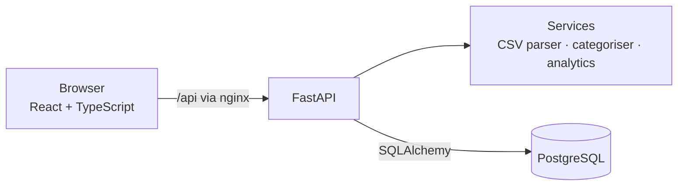

# 💷 Finance Dashboard

A full-stack personal finance app. Upload a bank statement CSV and it automatically categorises every transaction, skips duplicates, and shows where your money goes: income vs spending, savings rate and a category breakdown, month by month.

**Stack:** Python · FastAPI · SQLAlchemy · PostgreSQL · React · TypeScript · Recharts · Docker · GitHub Actions


<!-- TODO: run the app, take a screenshot of the dashboard, save it as docs/dashboard.png,
     then replace this comment with:    -->

---

## Features

- **Secure accounts:** registration and login with bcrypt-hashed passwords and JWT access tokens.
- **CSV import:** handles different bank formats (signed amount *or* money-in/money-out columns, UK and ISO dates, `£` symbols, Excel BOMs). Bad rows are reported by line number instead of failing the whole upload.
- **Duplicate protection:** every transaction gets a SHA-256 fingerprint, so uploading overlapping statements never double-counts.
- **Auto-categorisation:** rule-based categoriser for UK merchants (Tesco, TfL, Deliveroo, Netflix…), with manual override.
- **Dashboard:** monthly income, spending, net and savings rate; a 6-month income-vs-spending chart; spending by category.
- **Transactions:** add, edit, delete, search and filter by month or category.
- **One-command setup:** `docker compose up` runs Postgres, the API and the frontend together.

## Architecture



```
backend/
  app/
    main.py            # FastAPI app, CORS, router wiring
    config.py          # settings from environment variables
    models.py          # User and Transaction tables
    schemas.py         # Pydantic request/response validation
    security.py        # bcrypt hashing, JWT creation and verification
    routers/           # auth, transactions, analytics endpoints
    services/          # pure business logic, unit-tested in isolation
  tests/               # unit tests + end-to-end API tests
frontend/
  src/
    api.ts             # typed API client
    auth.tsx           # auth context (login state, token handling)
    pages/             # Dashboard, Transactions, Import, Login
sample-data/transactions.csv   # 6 months of realistic sample data
```

**Design decision:** the CSV parser, categoriser and analytics live in `services/` as plain Python functions with no database or web code. That keeps the business logic fast to test and easy to change, while the routers stay thin.

## Getting started

### Option 1: Docker (recommended)

```bash
docker compose up --build
```

Open http://localhost:8080, create an account, then import `sample-data/transactions.csv`.

### Option 2: run locally

**Backend** (Python 3.11+):

```bash
cd backend
python -m venv .venv
source .venv/bin/activate        # Windows: .venv\Scripts\activate
pip install -r requirements.txt
cp .env.example .env             # then set SECRET_KEY
uvicorn app.main:app --reload
```

The API runs on http://localhost:8000. Interactive docs are at http://localhost:8000/docs.

**Frontend** (Node 20+), in a second terminal:

```bash
cd frontend
npm install
npm run dev
```

Open http://localhost:5173. Vite forwards `/api` to the backend.

## API

| Method | Endpoint | Description |
|---|---|---|
| POST | `/api/auth/register` | Create an account |
| POST | `/api/auth/login` | Get a JWT access token |
| GET | `/api/auth/me` | Current user |
| GET | `/api/transactions` | List (filter by `month`, `category`, `q`) |
| POST | `/api/transactions` | Create (category auto-detected if omitted) |
| PUT / DELETE | `/api/transactions/{id}` | Update / delete |
| POST | `/api/transactions/import` | Upload a CSV statement |
| GET | `/api/analytics/summary` | Income, spending, net, savings rate |
| GET | `/api/analytics/monthly` | Income vs spending for the last N months |
| GET | `/api/analytics/by-category` | Spending totals by category |

## Security

- Passwords hashed with **bcrypt**; tokens are signed **JWTs** with an expiry.
- **Per-user data isolation:** every query is scoped to the logged-in user, and other users' records return `404` (not `403`) so IDs can't be probed.
- Login returns the same error for unknown email and wrong password, to prevent account enumeration.
- **Input validation** with Pydantic; SQL is built with SQLAlchemy bound parameters (no string concatenation, so no SQL injection).
- **Upload limits:** `.csv` only, 2 MB max, 5,000 rows max.
- Restricted CORS, security headers in nginx, and the API container runs as a non-root user.
- Secrets come from environment variables, and `.env` is git-ignored.

## Testing

```bash
cd backend
pytest -v
```

- **Unit tests** cover the CSV parser (formats, bad rows, limits), the categoriser and the analytics maths.
- **API tests** run end to end against a throwaway database: auth, validation, CRUD, CSV import and de-duplication, and a check that one user can never see another user's data.

GitHub Actions runs the backend tests, type-checks and builds the frontend, and builds the Docker images on every push.

## Roadmap

- Budgets per category with alerts when you're close to the limit
- Database migrations with Alembic
- Refresh tokens stored in httpOnly cookies
- Learn from manual re-categorisations, so the categoriser improves over time
- Deploy (Render / Railway for the API, Vercel / Netlify for the frontend)

## What I learned

<!-- Write 3–4 sentences in your own words: what was hardest, what you'd do differently, what you learned. -->

---

Built by **Isha Inani**: [Portfolio](#) · [LinkedIn](#) · ishainani985@gmail.com
